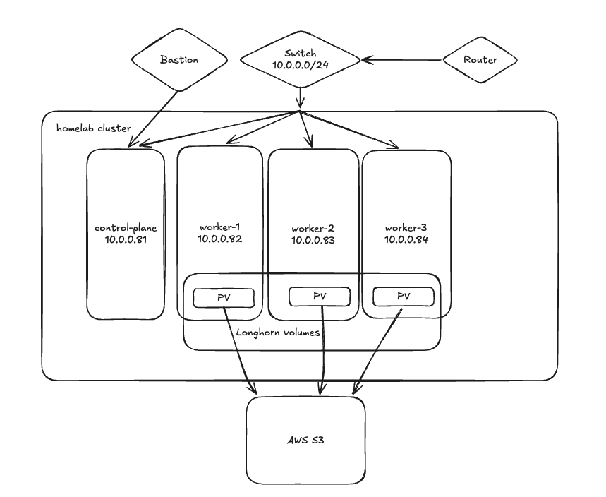

# k8s-cluster
The kubernetes homelab

## Cluster Topology

All four nodes sit on a single flat LAN segment (`10.0.0.0/24`) behind the home
router. The three workers contribute local disk to Longhorn, which replicates
volumes between them and ships backups off-site to AWS S3. The control plane is
tainted, so it runs no workloads and holds no Longhorn replicas.



## Infrastructure Specifications

**Prerequisites:**
- talosctl https://docs.siderolabs.com/talos/latest/getting-started/talosctl
- kubectl https://kubernetes.io/docs/tasks/tools/#kubectl
- helm https://helm.sh/docs/intro/install/
- flux-cli https://fluxcd.io/flux/installation/#install-the-flux-cli
- sops + age https://fluxcd.io/flux/guides/mozilla-sops/
- terraform https://developer.hashicorp.com/terraform/install
- git https://git-scm.com/downloads
- cloudflared https://developers.cloudflare.com/cloudflare-one/networks/connectors/cloudflare-tunnel/downloads/

**Hardware:** 4 nodes — 1 control plane + 3 workers

| Role | Hostname | IP | Model | CPU | RAM |
|------|----------|-----|-------|-----|-----|
| Control plane | control-plane | 10.0.0.81 | Dell OptiPlex 7010 | i3-3240, 4 cores | 8 GB |
| Worker | worker-1 | 10.0.0.82 | HP EliteDesk 800 G1 TWR | i5-4570, 4 cores | 16 GB |
| Worker | worker-2 | 10.0.0.83 | HP EliteDesk 800 G1 TWR | i5-4570, 4 cores | 16 GB |
| Worker | worker-3 | 10.0.0.84 | Dell OptiPlex 9020 | i3-4150, 4 cores | 8 GB |

**Operating System / Kubernetes Distribution:**
- **Talos Linux v1.14** - immutable, API-managed OS that runs Kubernetes (no SSH, no package manager)
- **Cilium** - CNI and kube-proxy replacement (Talos's flannel and kube-proxy are disabled)
- **Longhorn** - replicated block storage on `/var/mnt/longhorn` of each worker

The cluster was migrated from k3s on Ubuntu; see [docs/talos-migration.md](docs/talos-migration.md)
for how that was done.

## Repository Layout

| Path | Contents |
|------|----------|
| `talos/` | Talos machine config patches, Image Factory schematic, encrypted cluster secrets, Cilium values |
| `clusters/staging/` | Flux entrypoint: `flux-system` plus the `infrastructure`, `monitoring` and `apps` Kustomizations |
| `infrastructure/` | Cluster controllers and configs (cert-manager, Longhorn, Kyverno, Tailscale, Renovate, ...) |
| `monitoring/` | kube-prometheus-stack and Uptime Kuma |
| `apps/` | Linkding, Nextcloud, Firefly III, ... |
| `terraform/` | S3 bucket, IAM and `longhorn-backup-s3` Secret for Longhorn backups |

## Networking

- **Access**: Local network only
- **VPN**: Accessible via Tailscale VPN for remote access

## Building the Cluster

Every step is run by hand; there are no scripts. All commands run from the repository root.

### 1. Install Talos on the nodes

The Talos image comes from the [Image Factory](https://factory.talos.dev) with the
extensions Longhorn needs (`iscsi-tools`, `util-linux-tools`), defined in `talos/schematic.yaml`:

```bash
curl -sX POST --data-binary @talos/schematic.yaml https://factory.talos.dev/schematics
# ISO: https://factory.talos.dev/image/<schematic-id>/v1.14.2/metal-amd64.iso
```

Boot each node from a USB stick with that ISO. It comes up in maintenance mode with a
DHCP address; its static IP and hostname are only set once its config is applied.

### 2. Generate the machine configs

The cluster PKI is stored SOPS-encrypted in `talos/secrets.sops.yaml`. Each node has its
own patch in `talos/patches/` (static IP and hostname), so each worker gets its **own**
generated file. Never reuse one worker's file for another node: it would take over that
node's IP and hostname.

```bash
SOPS_AGE_KEY_FILE=age.agekey sops -d talos/secrets.sops.yaml > talos/secrets.yaml

talosctl gen config talos-cluster https://10.0.0.81:6443 \
  --with-secrets talos/secrets.yaml \
  --config-patch @talos/patches/common.yaml \
  --config-patch-control-plane @talos/patches/control-plane.yaml \
  --output-types controlplane --output talos/controlplane.yaml --force

# repeat for worker-2 and worker-3
talosctl gen config talos-cluster https://10.0.0.81:6443 \
  --with-secrets talos/secrets.yaml \
  --config-patch @talos/patches/common.yaml \
  --config-patch-worker @talos/patches/worker-1.yaml \
  --output-types worker --output talos/worker-1.yaml --force

rm talos/secrets.yaml
```

The generated files contain private keys and are git-ignored (`talos/.gitignore`).

### 3. Apply the configs and bootstrap

```bash
talosctl apply-config --insecure -n <maintenance-ip> --file talos/controlplane.yaml   # or talos/worker-N.yaml

export TALOSCONFIG=$PWD/talos/talosconfig
talosctl config endpoint 10.0.0.81
talosctl config node 10.0.0.81
talosctl bootstrap                                   # once, on the control plane only
talosctl kubeconfig ~/personal/kubeconfig
```

To change a running node later, edit its patch, regenerate its file, and apply with
`talosctl -n <node-ip> apply-config --file <file> --dry-run` first to review the diff.

### 4. Install Cilium

Cilium is installed with Helm, outside Flux, because nothing else can run until the CNI exists:

```bash
helm repo add cilium https://helm.cilium.io
helm upgrade cilium cilium/cilium --install --version 1.20.0 \
  --namespace kube-system -f talos/cilium/cilium-values.yaml
kubectl apply -f talos/cilium/cilium-lb.yaml        # LB pool 10.0.0.240-250 + L2 announcements
```

### 5. Create the Longhorn backup Secret

Terraform creates the S3 bucket and the `longhorn-backup-s3` Secret Longhorn uses as its backup target:

```bash
cd terraform
terraform init
terraform apply -var kubeconfig_path=~/personal/kubeconfig
```

## GitOps

- **GitOps Tool**: FluxCD
- **Purpose**: Automated deployment and configuration management

### Bootstrap FluxCD

1. **Set GitHub credentials**:
   ```bash
   export GITHUB_TOKEN=<your-token>
   export GITHUB_USER=<your-username>
   ```

2. **Verify prerequisites**:
   ```bash
   flux check --pre
   ```

3. **Create the SOPS age secret** in the `flux-system` namespace for decrypting encrypted secrets:
   ```bash
   kubectl create namespace flux-system
   kubectl -n flux-system create secret generic sops-age --from-file=age.agekey=age.agekey
   ```

4. **Bootstrap Flux to the cluster**:
   ```bash
   flux bootstrap github \
     --owner=$GITHUB_USER \
     --repository=k8s-cluster \
     --branch=main \
     --path=./clusters/staging \
     --personal
   ```

5. **Restore data** (rebuilds only): restore each volume from its S3 backup in the Longhorn UI
   and choose *Create PV/PVC* with *Use Previous PVC*, so the apps bind to the restored data
   instead of provisioning empty volumes.

## Available Application Endpoints

**Public Endpoints:**
- **Linkding bookmarking**: https://ld.edvsul.org
- **Nextcloud**: https://nextcloud.edvsul.org

**VPN-Only Endpoints:**
- **Grafana**: https://grafana.edvsul.org (requires Tailscale VPN)
- **Longhorn**: https://longhorn.edvsul.org (requires Tailscale VPN)
- **Hubble UI**: https://hubble.edvsul.org (requires Tailscale VPN)
- **Firefly III**: https://firefly.edvsul.org (requires Tailscale VPN)
- **Uptime Kuma**: https://uptime.edvsul.org (requires Tailscale VPN)

## How Traffic Reaches Applications

Applications are exposed through **two independent ingress paths**, depending on
whether they should be reachable from the public internet or only from the home
network / VPN.

### Publicly exposed apps (Nextcloud, Linkding) — Cloudflare Tunnel

These apps are reachable from anywhere with no inbound ports opened on the home
network. A `cloudflared` Deployment runs inside the cluster and dials **outbound**
to Cloudflare's edge, holding a persistent tunnel open.

```
Browser → Cloudflare edge (public DNS + TLS termination)
        → [outbound tunnel] → cloudflared pod
        → http://<app>:<port> (ClusterIP Service) → app pod
```

1. `ld.edvsul.org` / `nextcloud.edvsul.org` are CNAMEs in Cloudflare DNS pointing
   at the tunnel; they resolve to Cloudflare's edge.
2. Cloudflare terminates public TLS and pushes the request **down the existing
   outbound tunnel** — so no firewall rule, public IP, or LoadBalancer is needed.
3. `cloudflared` matches the hostname to an internal ClusterIP Service
   (e.g. `http://linkding:9090`) and proxies the request to the app pod.

### Internally exposed apps (Longhorn, Hubble, Grafana, ...) — Cilium ingress

These apps share a single Cilium ingress LoadBalancer at **`10.0.0.240`** and are
reachable only on the home LAN, or remotely over Tailscale.

```
Client → 10.0.0.240 (Cilium LoadBalancer VIP, L2-announced by one node)
       → Cilium eBPF LoadBalancer → local Envoy proxy (shared ingress)
       → TLS termination (*.edvsul.org) → route by Host header
       → backend ClusterIP Service → app pod
```

1. `*.edvsul.org` (hubble/grafana/longhorn/firefly) resolve to **`10.0.0.240`**, a Cilium
   `LoadBalancer` IP allocated from the `lan-pool` (`10.0.0.240–250`, `talos/cilium/cilium-lb.yaml`).
2. `10.0.0.240` is not bound to any NIC — Cilium **L2-announces** it (policy
   `lan-l2`): one node holds a lease and answers ARP for it on the LAN NIC (`eno1`).
3. Cilium's eBPF datapath redirects the connection to the node-local **Envoy**
   proxy. In `shared` mode a single Envoy/ingress config serves all these hosts.
4. Envoy terminates TLS with the `*.edvsul.org` wildcard certificate
   (issued by cert-manager, synced into the `cilium-secrets` namespace) and routes
   by `Host` header to the matching backend ClusterIP Service.

**Remote access (Tailscale):** `10.0.0.240` is a LAN-only address, so it is not
reachable over the VPN by default. An in-cluster Tailscale **operator + Connector**
runs a subnet router that advertises `10.0.0.240/28` into the tailnet. A remote
client with `--accept-routes` tunnels traffic for that range to the subnet-router
pod, which forwards it into the cluster (the rest of the chain above is identical).

```
Laptop (Tailscale, --accept-routes) → [WireGuard] → subnet-router pod
       → 10.0.0.240 → Cilium LoadBalancer → Envoy → app
```

> Note: the Kubernetes API (`10.0.0.81:6443`) and the Talos API (`10.0.0.81:50000`)
> are outside the advertised `10.0.0.240/28` range, so `kubectl` and `talosctl`
> work from the home LAN only.
